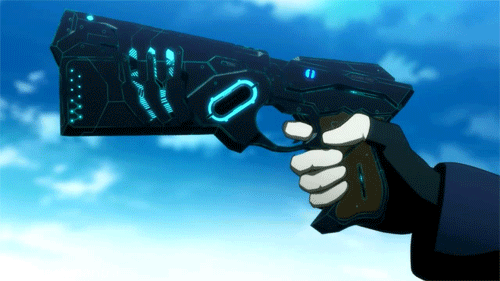
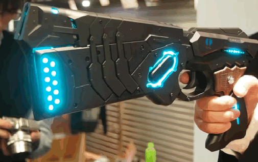
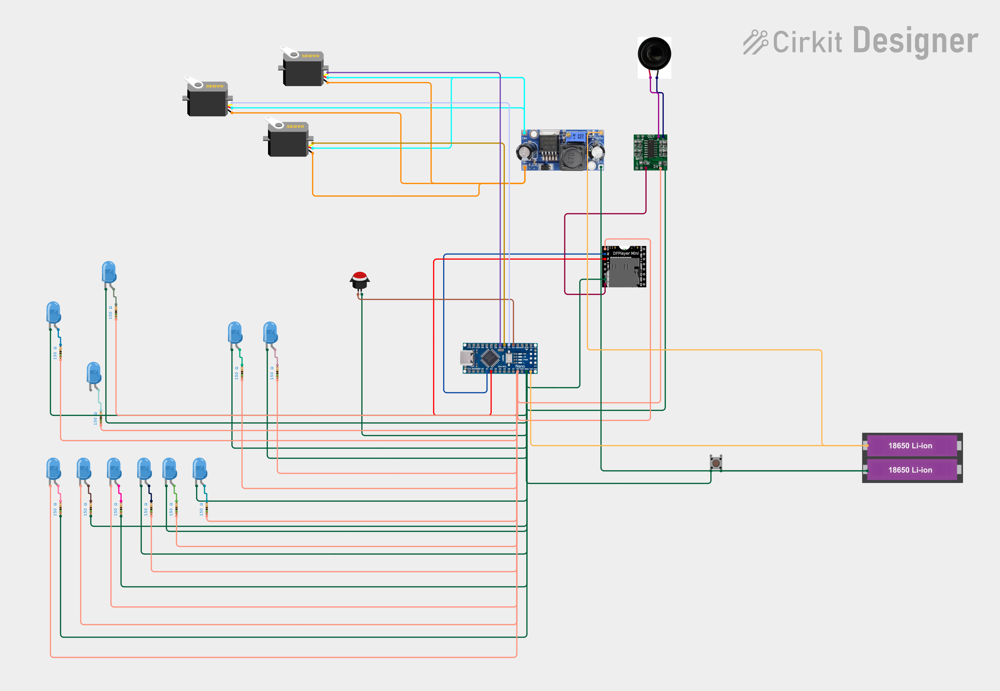

# Psycho-Pass Dominator cosplay prop

[Русская версия](README_RU.md)

Arduino Nano sketch for a reconstructed Psycho-Pass Dominator cosplay prop. It controls four servos, plays sounds through a DFPlayer Mini, and reads a trigger button. This is a reconstruction, not a verified original project source.

## Hardware

- Arduino Nano
- 4 compatible servos
- DFPlayer Mini and a microSD card
- Speaker and the amplifier shown in the supplied diagram
- Momentary trigger button
- Suitable power supply, regulator, wiring, and resistors

## Arduino libraries

- `Servo` (included with the Arduino IDE)
- `SoftwareSerial` (included with the Arduino IDE)
- `DFRobotDFPlayerMini` (install through Library Manager)

## Pin map

| Function | Arduino pin |
| --- | --- |
| Trigger button | D4 to GND (`INPUT_PULLUP`) |
| Servo 1–4 signals | D7, D5, D6, D8 |
| DFPlayer TX → Arduino RX | A1 |
| Arduino TX → DFPlayer RX | A2 through about 1 kΩ |

## Audio files

Format the microSD card as FAT32 and create an `/mp3` folder containing:

| File | Purpose |
| --- | --- |
| `0001.mp3` | Startup |
| `0002.mp3` | Opening/transformation |
| `0003.mp3` | Paralyzer |
| `0004.mp3` | Lethal Eliminator shot |

## Upload and calibration

1. Open `dominator_gun_psychopass.ino` in Arduino IDE.
2. Select the correct Arduino Nano board, processor, and port.
3. Install `DFRobotDFPlayerMini`, then compile and upload.
4. Disconnect the servo linkages and calibrate `CLOSED_ANGLES` and `OPEN_ANGLES` before operating the mechanism.
5. Set `STARTUP_AUDIO_MS` to the real duration of `0001.mp3`.

For bench testing, the Serial Monitor at 9600 baud accepts `p` (close), `l` (open), and `f` (play the current firing sound).

## Wiring diagram

> **Check before soldering:** the supplied diagram visibly shows three servos, while the sketch is configured for four. Verify every connection against your actual hardware. Do not power several servos from the Nano's 5 V pin; use a correctly rated regulated supply and connect all grounds together. Use protected cells/a suitable BMS and never short, overcharge, or over-discharge Li-ion cells.

## Safety

This is a non-functional cosplay prop. Follow local rules for replica props, use an orange tip or other required markings, and never carry or display it where it could be mistaken for a real weapon.
